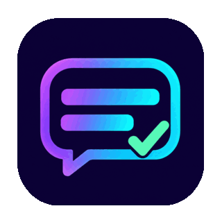

<p align="center"></p>

# Dreamstreaming Subtitle Tracker

Find movies and episodes with missing subtitles in Jellyfin Server 12.4. After your daily Wyzie Subs task runs, open the tracker to see which titles still need a subtitle track.

## 📦 Install from the Jellyfin catalog

1. Sign in as an administrator and open **Dashboard → Plugins → Repositories**.
2. Add a repository named **Dreamstreaming** and paste the following URL into **Repository URL**:

   ```text
   https://github.com/certified-dumbass/subtitle-checker/releases/latest/download/manifest.json
   ```

3. Save, open **Catalog**, select **Dreamstreaming Subtitle Tracker**, and click **Install**.
4. Restart Jellyfin when convenient, then open the tracker from the dashboard.

Catalog installation requires no API key or development tools.

## 🔎 Search movies, series and collections

The dashboard now supports a **live search box** (300 ms debounce), so you can jump to a title instead of paging through your entire library.

| Type | Search behavior |
| --- | --- |
| **Alles (titels)** | Search movie and episode titles (original default list). |
| **Films** | Search individual movies. |
| **Afleveringen** | Search individual episode titles. |
| **Series** | Search by *series name*, then click a series to inspect its episodes. |
| **Collecties** | Search by *collection name*, then click a collection to inspect its movies. |

**Ondertiteling: Nee / Ja** still filters movies and episodes based on whether Jellyfin has indexed any subtitle track. For **Series** and **Collecties**, the matching names appear first regardless of subtitle status; click one to see only its matching episodes or movies. Within an opened group, the page also shows counts of titles **with and without** subtitles, and a **Terug naar zoekresultaten** button returns to the previous results page.

Search and paging use Jellyfin's own item index and respect the libraries visible to the signed-in account. No whole-library browser download or custom API key is needed. Searches for an entire series or collection are available through the corresponding **Type** choice, not the default mixed-title search.

## 🔎 Check subtitle coverage

The plugin controls are currently in Dutch. The default view lists titles with missing subtitles.

| Control | What it does |
| --- | --- |
| **Ondertiteling** | Select **Nee** (No) for titles with zero indexed subtitle tracks or **Ja** (Yes) for titles with one or more. |
| **Type** | Choose **Films** (Movies), **Afleveringen** (Episodes), **Series**, **Collecties**, or **Alles (titels)** (Movies and Episodes). Episode rows include the series name and available season and episode numbers. |
| **Zoeken / Wissen** | Search by title or group name; clear your query in one click. |\n| **Series / Collecties** | Select a matching series or collection to inspect its episodes/movies and see total counts with and without subtitles. |\n| **Vorige / Volgende** | Move through results in pages of up to 50, ordered by sort title. The counter shows the visible range and the total for your filters. |
| **Vernieuwen** | Refresh the results from Jellyfin’s index for the libraries your account can access. |

Any language counts. For example, a movie with only a German subtitle track appears under **Ja**. Jellyfin can index embedded tracks and external files such as SRT subtitles. Burned-in captions are part of the video image and do not count as a separate track.

The coverage page reads indexed tracks. The separate scheduled task below delegates downloads to Wyzie. The tracker reads Jellyfin’s index without recording watch history. If a newly downloaded track is missing, check the title’s media information, rescan its library if needed, and click **Vernieuwen**.

## 🔄 Automatic English subtitles with Wyzie

Enable Wyzie Subs and select English as a download language for each relevant library. After installing the update and restarting Jellyfin, open **Dashboard → Scheduled Tasks → Dreamstreaming → Find missing English subtitles (Wyzie)**. Run it manually or adjust its default daily 03:00 trigger. Avoid overlapping it with Jellyfin’s built-in subtitle task.

Each run checks local movie and episode files, including titles with English audio or subtitles in other languages. A full indexed English track (including SDH) skips the search; a forced-only English track does not. The task allows non-hash-matched results and uses Wyzie’s automated search mode. Check timing if a different release was matched.

A run searches at most 100 eligible titles, not 100 API requests. Wyzie applies its own quota. A persistent cursor rotates through the library, including past previously unmatched items; unknown or empty results do not prove no subtitles exist. The server log records the summary and successful downloads. The coverage page still reports any language.

## 🧰 Manual installation

Download the plugin ZIP from [Releases](https://github.com/certified-dumbass/subtitle-checker/releases/latest), extract the DLL into its own folder inside the `plugins` directory of your Jellyfin data folder, and restart Jellyfin. To uninstall, use the plugin dashboard.

## 🛠️ Build on Windows

Install the .NET SDK matching the target framework in your server’s `jellyfin.runtimeconfig.json`. Open PowerShell in the extracted source directory and run:

```powershell
powershell -NoProfile -ExecutionPolicy Bypass -File .\Build.ps1
```

For a custom server location, append `-ServerDir "D:\Jellyfin\Server"`. The compiled DLL is written to `output\`.

## 🚀 Publish a release

The GitHub Actions workflow builds against assemblies from the official Jellyfin 12.4 container. Each release includes the plugin ZIP and a Jellyfin manifest with the ZIP’s MD5 checksum. Bump the version in `Tracker.csproj` before pushing a new plugin version to `main`.
